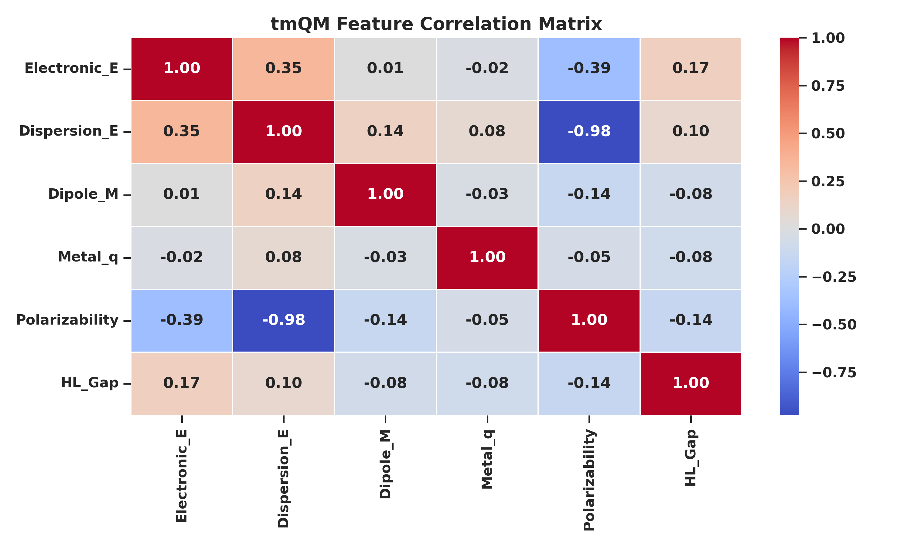
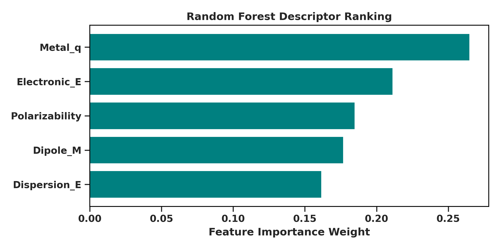
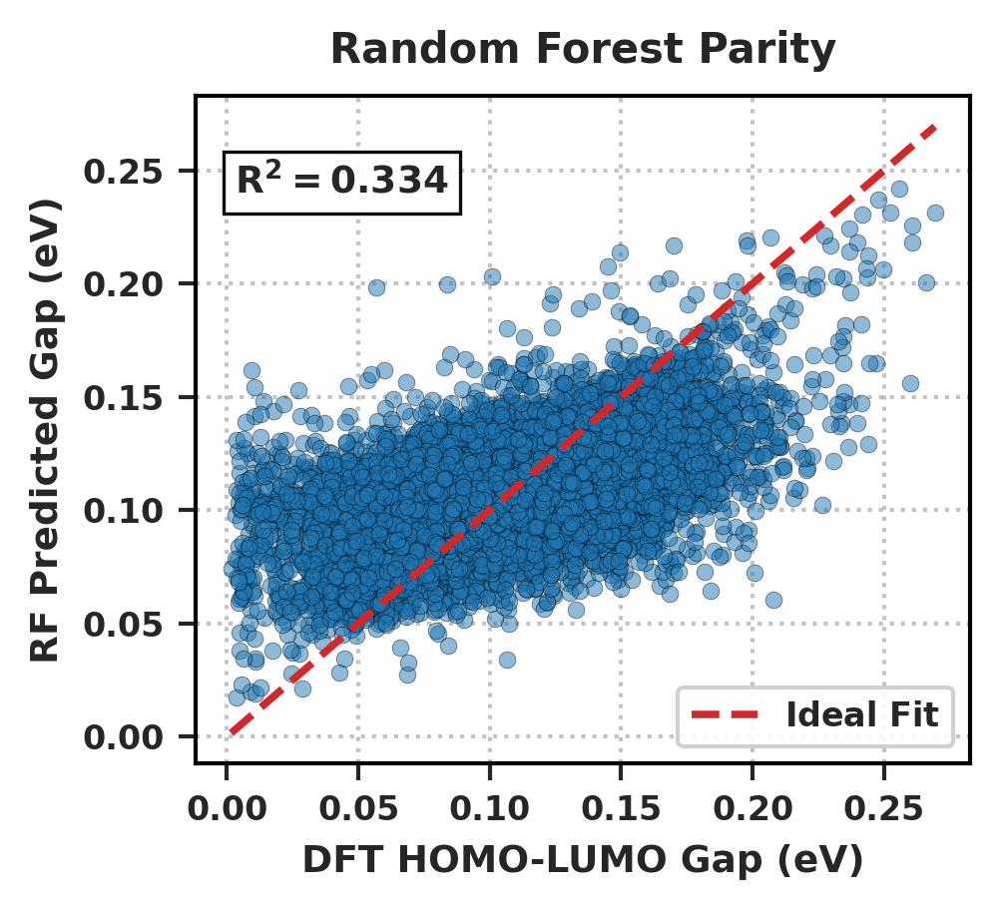

# Benchmarking Machine Learning Models for HOMO–LUMO Gap Prediction in the tmQM Complex Dataset

This repository contains the dataset preprocessing scripts, model training pipelines, and figure-generation workflows for benchmarking non-spatial machine learning surrogate models on the 2024 release of the tmQM (Transition Metal Quantum Mechanics) dataset.

## Dataset

- **Source:** [tmQM 2024 release](https://github.com/uiocompcat/tmqm) — `tmQM/tmQM_y.csv`
- **Complexes:** 108,541 mononuclear transition metal complexes
- **Features (5):** `Electronic_E`, `Dispersion_E`, `Dipole_M`, `Metal_q`, `Polarizability`
- **Target:** `HL_Gap` (HOMO–LUMO gap, eV)
- **Leakage safeguard:** `HOMO_Energy`, `LUMO_Energy`, `CSD_code`, `SMILES`, and `CSD_years` are excluded from all training features.

The 2020 tmQM release (86,665 complexes) was intentionally excluded due to ~86,000 shared CSD codes with the 2024 release. Concatenating the two releases would double-count most complexes and inflate held-out metrics.

## Benchmark Results

| Model Architecture | Test R² | Test RMSE (eV) |
|---|---|---|
| Linear Regression Baseline | 0.086 | 0.032 |
| XGBoost Regressor | 0.271 | 0.029 |
| **Random Forest Regressor** | **0.334** | **0.027** |

Random Forest used `n_estimators=100`, `random_state=42`, `n_jobs=-1`.
XGBoost used `n_estimators=100`, `learning_rate=0.1`, `random_state=42`.
All three models were trained on an identical 80/20 train/test split (`random_state=42`, `test_size=0.2`, `N_test = 21,709`).

### Key Findings

- **Dominant descriptors:** Metal partial charge (`Metal_q`) and total electronic energy (`Electronic_E`) rank as the most influential global scalar features.
- **Non-linear interactions:** `Metal_q` has weak marginal linear correlation with the target (r = −0.08) but high tree-based importance, reflecting non-linear interaction effects.
- **Low empirical ceiling:** Global scalar descriptors reach only R² ≈ 0.33, confirming that spatial ligand-field information is required for accurate frontier orbital gap prediction.
- **Architectural comparison:** Random Forest outperforms XGBoost by ~0.06 R² on this feature set; Linear Regression is far weaker (0.086).

## Repository Structure

```
├── feature_importance.png          # Random Forest descriptor importance ranking
├── real_parity_plot.png            # Random Forest parity plot (DFT vs. ML, R² = 0.334)
├── tmqm_correlation_matrix.png     # Pearson correlation heatmap of scalar descriptors
├── run_pipeline.py                 # Main execution pipeline (Steps 1–4)
├── requirements.txt                # Python dependencies
├── LICENSE
└── README.md
```

## Reproducing the Results

```bash
pip install -r requirements.txt
python run_pipeline.py
```

The pipeline will:

1. Clone the tmQM repository (2024 release)
2. Load and clean `tmQM_y.csv`
3. Train Linear Regression, XGBoost, and Random Forest
4. Print benchmark metrics to stdout
5. Generate the three figures listed above

If the tmQM repository cannot be cloned, the pipeline raises an exception and exits — it never substitutes synthetic or fallback data.

## Requirements

See `requirements.txt`. Core dependencies: `numpy`, `pandas`, `scikit-learn`, `xgboost`, `matplotlib`, `seaborn`.

## Citation

If you use this code, please cite:

> Kashan. *Benchmarking Machine Learning Models for HOMO–LUMO Gap Prediction in the tmQM Complex Dataset.* (in review).

## Figures

### Feature Correlation Matrix



### Random Forest Feature Importance



### Random Forest Parity Plot



## License

See LICENSE file.
